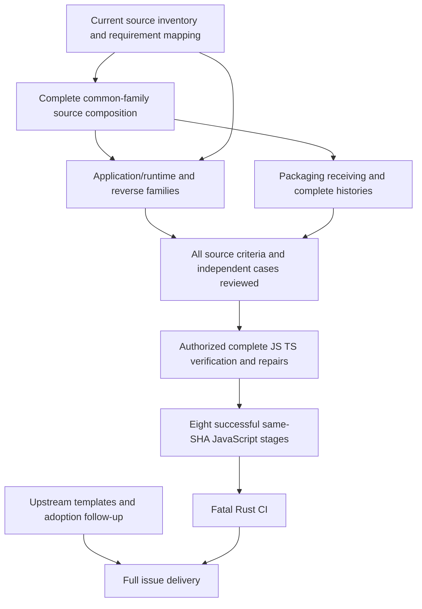

# Completion forecast and decision rules

Baseline: `ba7b1d9f99f9be16628fe433a097b1b8ff036f43`, November1,2026.
This forecast is **engineering judgment under explicit assumptions**, not a
measured completion rate, statistical confidence interval or promised date.
The current source-only/no-CI-feedback policy remains unchanged.

## What finish means

There are three materially different milestones:

| Milestone | Required outcome | What does not qualify |
| --- | --- | --- |
| Source draft complete | Every applicable source requirement has implementation, independent case source and a reviewed receipt; original issue obligations and all actual inventory entries are accounted for. | A growing file count, candidate source or merely writing a checklist. |
| Verified Router delivery | Current native JS behavior and strict TS match the Router contract; complete source translates both directions, sync/export/freshness work, all eight same-SHA JS stages pass and gated fatal Rust CI passes. | Historical6% coverage, green subsets, carried Rust, native-only baselines or a merged checkpoint. |
| Reusable adoption delivered | Real receiving repositories qualify the exported translator/core/gates; shared template/hive-mind work and deduplicated adoption/audit obligations are completed or explicitly still open. | Copying files, opening an issue, a draft upstream patch or local-only acceptance. |

The estimate concerns the **finite current Router application**, Node20+/Bun,
strict lockfile TypeScript5.9.3, declared platform profiles and explicitly
matching native-library boundaries allowed by the user. It does not estimate
an unrestricted general-purpose Rust↔arbitrary-JS compiler. A broader language
product needs a separate inventory and estimate.

## Why a precise date is not defensible yet

- L01/L02 still lack the complete current function/feature/cfg assignment.
-62/70 source bundles remain open; the open bundles have very different sizes.
- Seven of the eight closed bundles are policy/CI source accounting. Using their
  closure rate to predict full async/stream/reverse support is invalid.
- Recent work is UNRUN, and latest CI/review evidence is uninspected. Its
  integration failure rate and actual production unlocks are unknown.
- Historical163/2,570 and155/2,567 counts have different source universes; no
  comparable fixed-denominator current time series is available.
- One commit can contain a one-line note or a301-path source-history batch.
  Commit frequency cannot be converted into hours per function.
- Full reverse edit mapping and platform/runtime contracts have a long tail;
  passing a primitive family does not size that tail.

Therefore neither “a few more commits” nor a precise percent-complete date is
supported. The following ranges make the uncertainty and assumptions visible.

## Bottom-up planning model

An **agent-role hour** is one focused hour of source implementation/review or
later verification/repair by one role. It is not CPU time, a billing measure,
human-hour equivalence or a quantity measured in this audit. These estimates
are provisional work budgets for the remaining scope. They deliberately
separate current draft closures from full application behavior.

| Package | Concrete remaining output | Provisional agent-role hours | Main dependency/risk |
| --- | --- | ---: | --- |
| W1 Scope and caller assignment | Finish L01/L02: every actual production item/feature/producer, cfg/platform path and unresolved family mapped. |16–48 | Generated items/traits and source-only inventory review. |
| W2 Current common-family composition | Finish constant profile, opaque adoption, scoped aliases/block operands, canonical reader folding and callback cascade; actual whole-owner source/inverse/receiving cases. |24–96 | Shared Host/project/source-frame dependencies and full history/projection correctness. |
| W3 Remaining reusable language/core families | Missing control, aggregate mutation, ownership/loans, Option/Result/Try, helper/trait/import/producer and corresponding inverse rules from the inventory. |80–240 | Actual remaining family count is unknown; existing drafts may cover much of it or fail to compose. |
| W4 Native Router runtime feature parity | Actual CLI/config/account/auth/provider/storage/proxy/HTTP/stream/state behavior and matching owned framework boundaries. |180–540 | The historical443-feature/368-route inventory is not a current complete implementation. Cancellation/ordering/error behavior can require substantial work. |
| W5 Reverse editing and synchronization | Editable JS/TS subset, exact paired projections, canonical Rust, conflict/direction/rename/deletion and semantic inverse across application families. |80–240 | Unique original edits after expansion; ownership replay; current corpus round trips. |
| W6 Packaging, receiving and resources | Fresh canonical/platform/owned/reverse/export closure; copied repository operation; strict TS; bounded storage/lifecycles. |60–180 | Whole-workload fit, mutable source succession, actual TS origin and platform differences. |
| W7 Independent full application case source and closure review | Broader endpoint/CLI/state/stream/error/platform fixtures, complete harness mapping and all source receipts. |80–240 | This is integration/feature evidence beyond family unit cases already included in W2–W5. |
| W8 Upstream delivery and audit follow-up | Actual shared-template/hive-mind updates and existing adoption/audit issue follow-through, with deduplication and provenance. |16–64 | Other repository acceptance and operator/configuration dependencies are external. |
| W9 Authorized complete verification and coordinated repairs | Complete Node/Bun/strict TS, all output freshness/export/receiving, complete same-SHA JS gate and fatal Rust CI, fixes and requalification. |80–240 | Cannot begin early under current policy; CI elapsed time, failure population and environment availability unknown. |
| Total model | Disjoint remaining work budgets, with family tests in their family and broader end-to-end cases in W7. |616–1,888 | Not a measured backlog or confidence interval. Reconcile after actual inventory. |

This range is not obtained by multiplying missing functions by an invented
constant. It is a transparent provisional breakdown that can be replaced as
work packages gain inventories and receipts. It can be wrong in either
direction. Unobserved semantic gaps can exceed the upper numbers.

With four fully available roles at40focused hours each per week, the arithmetic
minimum is about3.9–11.8weeks. That assumes perfect parallelism, which this
project does not have. Shared compiler frames, serialized integration, source
review, original/final graph composition and the source-before-verification
phase boundary add critical-path time. The resulting **working planning range
is6–16 active team weeks**.

“Active team week” here assumes roughly40coordinator hours and up to three
available workers. It does not assert that this availability occurred in the
commit history. Continuous around-the-clock model availability could compress
some calendar intervals; operator availability, disk/host contention, pauses
and CI queues can lengthen them. Dividing every estimate by four or by three
would be unjustified.

## Scenarios

| Scenario | Planning range from the baseline | Assumptions | Confidence |
| --- | --- | --- | --- |
| Favorable reuse |3–5active team weeks | Existing source families largely compose; native runtime gaps mostly already implemented; inventory finds few new families; reverse/receiving fixes are small; verification is authorized when the complete draft exists. | Low. These assumptions have not been demonstrated. |
| Working bounded-Router plan |6–16active team weeks | Stable finite scope; shared native compatibility boundaries accepted; W1–W9 remain near the model; four roles available; one publisher; later verification exposes a manageable repair set. | Low, but more realistic than a days-only full-delivery promise. |
| Adverse semantic/resource tail |3–6calendar months or longer | Async/stream/state/trait/generic/reverse gaps are large, complete profiles fail resource envelopes, or source-only integration reveals extensive late repairs and external adoption delays. | Plausible risk, not a probability estimate. No proven upper bound. |

At an uninterrupted40-hour coordinator week starting November1, the working
range corresponds approximately to **mid-December2026 through late-February2027**.
Those dates are arithmetic illustrations of the assumptions, not commitments.
They do not include an assurance that external repositories merge on schedule.
No claim such as “80% by tomorrow” or “guaranteed100% next week” is supported.

## Near-term milestones that can be sized more narrowly

| Milestone | Planning budget | Required evidence/change to forecast |
| --- | --- | --- |
| Finish the three current shared source batches and their integration review |1–3active team days, if no additional private-hook gaps arise | Frozen complete source histories, full actual-owner cases and explicit remaining refusals. No execution assumed. |
| Complete the source inventory/caller reconciliation pass |1–3active team days, potentially longer for producers | Explicit complete assignments and a stable denominator, or a precise list of unknown generated/cfg items. |
| Review full remaining source work against W1–W8 | After those milestones | Replace guesses with actual family/feature counts; revise this forecast even if the revision is slower. |
| First complete end-to-end verification/repair cycle |1–3active days **after** the whole draft and execution authorization, excluding unknown full CI queue/runtime | Actual whole-source Rust↔JS/TS path, Node/Bun/strict TS, fresh receiving/export and complete gate observations. Failures reopen source rows. |

These budgets are not evidence that the full project will finish in six days.
The first two milestones reduce uncertainty; the rest of the application and
reverse/runtime feature scope still has to be completed. The current policy
prevents using verification to calibrate the estimate before the full source
phase. We preserve that policy and its uncertainty cost.

## Critical path and parallel work

The graph shows dependencies, not durations. Three source workers improve
independent family drafting; they do not remove the coordinator's integration
path or make full verification run before source completion. The coordinator
also owns this audit, exact-path commits and publication; that time must not
be treated as free parallel capacity.

## Forecast update triggers

Re-estimate at each meaningful coherent checkpoint, using these observations:

1. Inventory mapped/total, unassigned production entries and actual unresolved
   macro/cfg/trait producers. Do not reuse a stale function denominator.
2. Whole source bundles closed and their size/class, keeping policy, language,
   runtime, reverse and delivery work distinguishable.
3. Actual full production callers reaching complete qualified behavior, once
   execution is authorized; record both numerator and exact input revision.
4. Newly discovered shared composition failures, especially scope, callbacks,
   reverse source mapping and whole-frame lifetime/namespace gaps.
5. Actual full-workload timing/RSS/disk, strict TS/export/freshness and complete
   CI outcome populations, once inspection/execution is authorized.
6. External template/adoption dependencies and any changed user scope or phase
   policy. Preserve the old estimate with its assumptions rather than hiding it.

If two successive checkpoint periods add source artifacts without closing an
actual dependency bundle, review the architecture/work selection. During the
source-only phase this means source review and a revised implementation batch,
not a covert test run. If the full source inventory reveals significantly more
runtime work than W4 assumes, widen the estimate immediately.

## How to shorten the critical path within current constraints

- Reuse the real existing field/default/filter/text/callback selectors. Add the
  missing scoped/block/cascade adapters instead of duplicating operations.
- Finish whole callers and both edit directions per family, including all
  required case source, before inventing another disconnected profile.
- Factor shared private source/ownership interfaces and full-history transport
  once; retain every original byte/inverse and unchanged refusal domain.
- Keep native frameworks behind matching owned contracts instead of attempting
  to translate framework internals. Do not hide untranslated application code
  inside those boundaries.
- Review existing implementation against receipts before writing replacements.
  Commit frequency is already high; more tiny commits are not the target.
- Preserve complete deferred failure/measurement obligations so verification
  later starts from one coherent source candidate rather than accumulated
  undocumented assumptions.

The source work continues. This estimate is a planning aid and a reason to
improve the plan; it is not a reason to stop or relax the completion contract.
